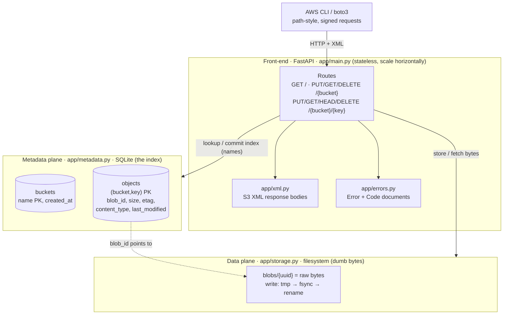
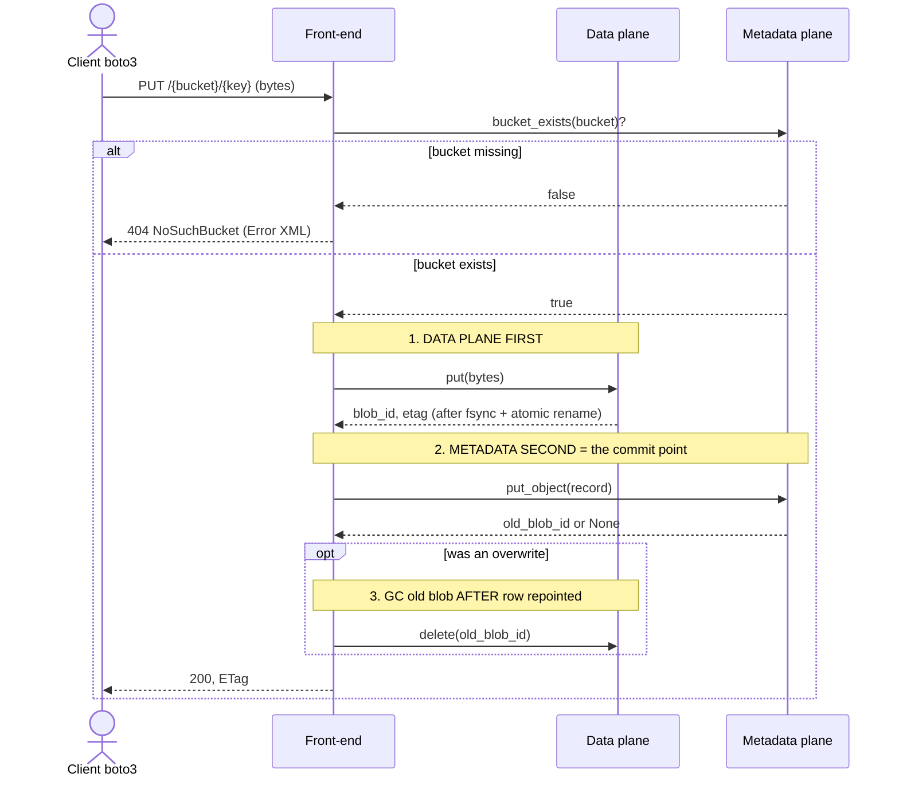
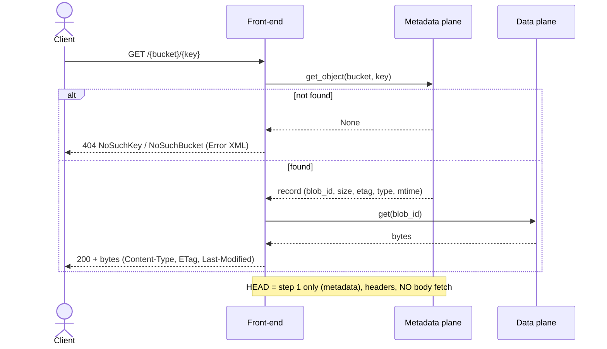
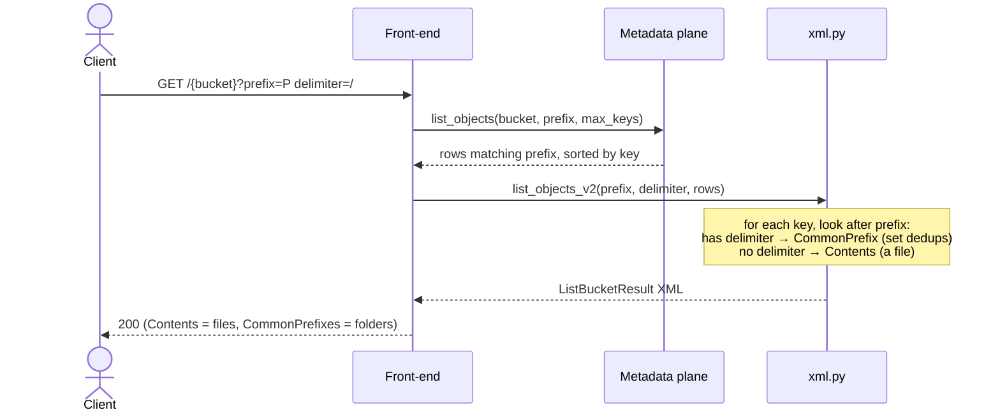
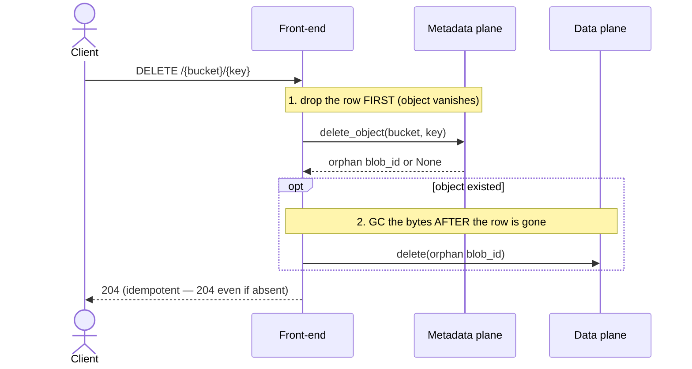
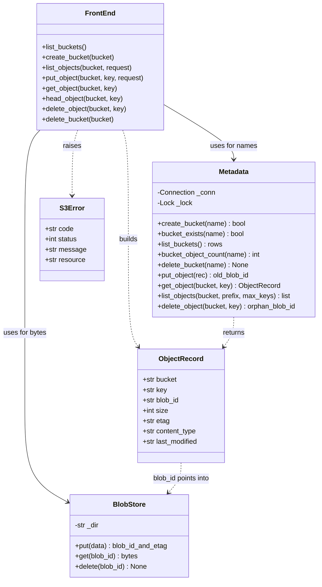

# local-s3 — Diagrams (revision sheet)

Three views of the solution, for remembering it end to end. (Diagrams are
Mermaid; GitHub renders them inline. `system-design.svg` is a static alternative.)

- [1. System design](#1-system-design-architecture)
- [2. Sequence diagrams](#2-sequence-diagrams) — PUT, GET/HEAD, LIST, DELETE
- [3. UML class diagram](#3-uml-class-diagram)
- [Invariants to remember](#invariants-to-remember)

---

## 1. System design (architecture)

The one big idea: **two planes joined by a `blob_id` pointer.** The front-end is
stateless; all state lives in the planes.



| Plane | File | Holds | Scales via |
|------|------|-------|-----------|
| Metadata | `metadata.py` | names → `blob_id` + attrs | shard on `(bucket,key)` |
| Data | `storage.py` | raw bytes by UUID | add storage nodes; replicate/erasure-code |

---

## 2. Sequence diagrams

### 2a. PUT object — the write-order rule

**Bytes first, index row second, GC last.** (orphan blob = safe garbage; dangling row = corruption)



### 2b. GET / HEAD object — the two-step read



### 2c. LIST objects — folders as a read-time view



### 2d. DELETE object — row first, then GC



---

## 3. UML class diagram



`FrontEnd` = the FastAPI routes in `app/main.py`; XML bodies come from `app/xml.py`.

---

## Invariants to remember

1. **Two planes.** Metadata = names/index (SQLite); Data = bytes (files). Joined
   by `blob_id`. Only metadata understands `(bucket, key)`.
2. **Flat namespace.** A key like `2024/cat.jpg` is one opaque string. No folders
   are stored; the `/` is just a character.
3. **Write order (PUT):** bytes → index row → GC old blob. *Orphan blob = safe
   garbage; dangling row = corruption.* The metadata commit is when the object
   "exists."
4. **Delete order:** drop the row first, then GC the bytes (same invariant, flipped).
   Delete is **idempotent** → always `204`.
5. **Reads:** GET touches both planes; HEAD and LIST touch **only** metadata →
   cheap regardless of object size.
6. **Folders are a read-time view.** `delimiter` groups flat keys into
   `CommonPrefixes` per request (a `set` dedups); nothing hierarchical is stored.
7. **Durability** is a data-plane job (fsync + atomic rename → later replication).
   **Namespace consistency** is a metadata-plane job (commit the row last).
8. **Compatibility is a wire contract:** exact S3 XML + `Error`/`Code` + quoted
   ETags + unmodified Content-Type → the real boto3 SDK just works.
```
